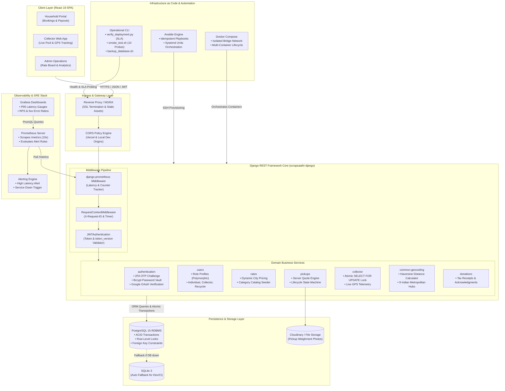
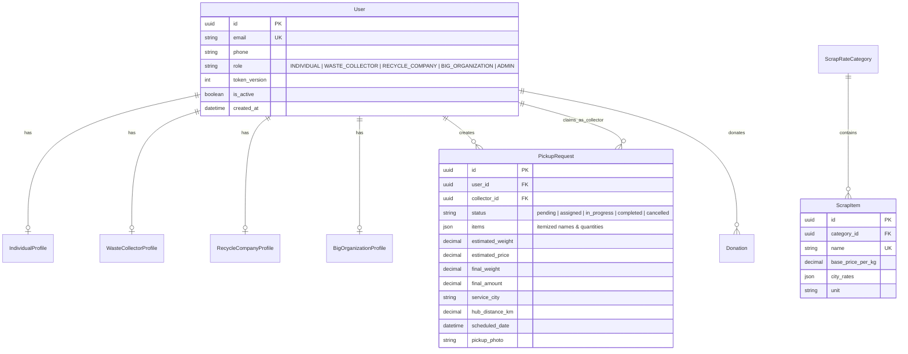

# ScrapSaathi: Smart Doorstep Scrap Logistics & Recycling Platform

> **Production-grade scrap collection, dynamic pricing, and live logistics platform** built with **Python 3.12**, **Django REST Framework (DRF)**, **PostgreSQL**, **React (Vite)**, and enterprise **DevOps & Observability infrastructure** (Docker, Ansible, Prometheus, Grafana, Linux Shell Automation).

---

## 📑 Table of Contents

1. [System Overview & Key Capabilities](#1-system-overview--key-capabilities)
2. [High-Level Architecture Design (HLD)](#2-high-level-architecture-design-hld)
3. [Domain Services & Core Components](#3-domain-services--core-components)
4. [Relational Data Modeling & ACID Concurrency](#4-relational-data-modeling--acid-concurrency)
5. [Security & Authentication Architecture](#5-security--authentication-architecture)
6. [API Architecture & Service Contracts](#6-api-architecture--service-contracts)
7. [Observability Stack: Prometheus & Grafana](#7-observability-stack-prometheus--grafana)
8. [Infrastructure as Code: Ansible Automation](#8-infrastructure-as-code-ansible-automation)
9. [Operational Automation: Python & Bash CLI](#9-operational-automation-python--bash-cli)
10. [Local Development & Docker Compose Setup](#10-local-development--docker-compose-setup)
11. [Automated Test Suite & Verification Results](#11-automated-test-suite--verification-results)
12. [Production Deployment Guide](#12-production-deployment-guide)

---

## 1. System Overview & Key Capabilities

**ScrapSaathi** bridges the fragmented informal waste management sector in India with digital logistics, transparent digital weighment, and instant settlements. It connects individual households, commercial enterprises, waste collectors (*kabadiwalas*), and institutional recyclers onto a single unified platform.

### Core Technical Capabilities
* **Dynamic City Pricing Engine**: Computes effective scrap rates across 5 scrap categories (Paper, Metals, Large Appliances, E-Waste, Plastics) with city-level rate overrides and fallback defaults.
* **Server-Side Quote Immutability**: Calculates price estimates server-side using current rate boards and locks in rate snapshots at booking creation to eliminate client-side tampering.
* **Haversine Geofencing Service**: Accurately computes geodesic distances between pickup coordinates and 9 major Indian metropolitan logistics hubs (Delhi NCR, Mumbai, Bengaluru, Pune, Hyderabad, Chennai, Kolkata, Ahmedabad, Jaipur), rejecting out-of-bounds requests (>75km).
* **Atomic Concurrency Engine**: Implements database row-level locks (`SELECT FOR UPDATE`) within ACID transactions when waste collectors claim bookings, preventing race-condition double bookings and returning instant `HTTP 409 Conflict` to concurrent contenders.
* **Stateful JWT Session Revocation**: Enforces single-session or global logout invalidation via per-user database `token_version` counters without requiring heavy in-memory blacklists.
* **Full-Stack Observability**: Native instrumentation with `django-prometheus` serving real-time metrics at `/metrics`, scraped by **Prometheus** every 10s and visualized via provisioned **Grafana** dashboards.

---

## 2. High-Level Architecture Design (HLD)

The following Mermaid architectural diagram represents the complete end-to-end system topology across clients, ingress, business applications, persistence, monitoring, and infrastructure automation:



---

## 3. Domain Services & Core Components

### 3.1 Authentication & RBAC Service (`authentication`, `users`)
- **Two-Factor Challenge**: User registration requires a valid 6-digit OTP verified against an HMAC token challenge (`verificationToken`).
- **Stateful JWT Session Revocation**: Tokens include a `token_version` claim. Logging out or resetting passwords increments `token_version` in the database, instantly invalidating all active tokens without server restart.
- **Polymorphic Role Profiles**: Four distinct role profiles (`IndividualProfile`, `WasteCollectorProfile`, `RecycleCompanyProfile`, `BigOrganizationProfile`) linked via One-to-One relationships with strict referential integrity.

### 3.2 Dynamic Pricing & Rate Board (`rates`)
- Manages 19 standard scrap items categorized into Paper, Metals, Large Appliances, E-Waste, and Plastics.
- Rates support city-specific pricing (e.g., Delhi NCR, Mumbai, Bengaluru) with automatic base price fallback when city-specific rates are not defined.

### 3.3 Pickup Logistics & Quote Engine (`pickups`, `collector`)
- **Server Quote Generation**: Multiplies estimated item weights by current city rates and locks the quote at booking creation.
- **Atomic Collector Acceptance**: Uses `select_for_update()` inside database transactions:
  ```python
  with transaction.atomic():
      pickup = PickupRequest.objects.select_for_update().filter(id=pk).first()
      if pickup.status != 'pending' or pickup.collector is not None:
          return api_failure("Pickup already claimed by another collector.", status_code=409)
      pickup.collector = request.user
      pickup.status = 'assigned'
      pickup.save()
  ```
- **Lifecycle Pipeline**: Manages transition through states: `pending` ➔ `assigned` ➔ `in_progress` ➔ `completed` (or `cancelled`).
- **Telemetry**: Collectors broadcast live GPS coordinates (`latitude`, `longitude`) to provide real-time tracking for customers.

### 3.4 Geocoding & Hub Serviceability (`common.geocoding`)
- Built-in coordinates for 9 Indian logistics centers.
- Haversine formula calculation validates whether customer coordinates fall within the maximum operating radius (75 km).

---

## 4. Relational Data Modeling & ACID Concurrency

### Entity-Relationship Diagram



---

## 5. Security & Authentication Architecture

1. **Password Hashing**: Standard Django `PBKDF2` / `Bcrypt` algorithm with 12 salt rounds.
2. **JWT Dual Transmission**: JWT tokens are returned in the JSON payload for mobile/API clients and simultaneously set in secure `httpOnly` cookies for web browsers to protect against XSS attacks.
3. **Request Tracing**: `RequestContextMiddleware` generates a unique UUID `X-Request-ID` for every inbound request and injects it into both structured logs and response headers.
4. **Input Validation**: Strict serializers ensure all numeric fields (latitudes, weights, prices) are validated prior to ORM execution.

---

## 6. API Architecture & Service Contracts

All endpoints return a standardized JSON envelope:
```json
{
  "success": true,
  "message": "Human readable status message",
  "data": { ... },
  "meta": { "timestamp": "2026-10-09T08:00:00Z" },
  "errors": []
}
```

### Key API Endpoints Reference

| Method | Endpoint | Description | Auth Required |
| :--- | :--- | :--- | :--- |
| `POST` | `/api/v1/auth/otp/send-registration` | Dispatches 6-digit verification OTP | Public |
| `POST` | `/api/v1/auth/otp/verify-registration` | Verifies OTP and returns challenge token | Public |
| `POST` | `/api/v1/auth/register` | Creates user account with challenge token | Public |
| `POST` | `/api/v1/auth/login` | Authenticates user; returns JWT & cookie | Public |
| `POST` | `/api/v1/auth/logout` | Increments `token_version` to revoke session | Authenticated |
| `GET` | `/api/v1/rates?city=delhi-ncr` | Returns scrap rate catalog with effective city prices | Public |
| `POST` | `/api/v1/pickups` | Submits new pickup; locks server quote | Authenticated |
| `GET` | `/api/v1/pickups/user/my` | Retrieves history of authenticated user's pickups | Authenticated |
| `GET` | `/api/v1/collector/available-pickups` | Lists unclaimed pickups within radius | Collector Role |
| `POST` | `/api/v1/collector/pickups/<id>/accept` | Claims pickup atomically (`SELECT FOR UPDATE`) | Collector Role |
| `POST` | `/api/v1/collector/pickups/<id>/complete` | Records final weighment and settles payout | Collector Role |
| `POST` | `/api/v1/collector/location` | Broadcasts collector GPS coordinates | Collector Role |
| `GET` | `/api/v1/geocode/serviceable?lat=...&lon=...`| Validates coordinate serviceability | Public |
| `GET` | `/metrics` | Exposes real-time Prometheus telemetry | Internal / Scraper |
| `GET` | `/health` | Lightweight service health probe | Public |

---

## 7. Observability Stack: Prometheus & Grafana

### Prometheus Configuration
Configured in [`monitoring/prometheus.yml`](monitoring/prometheus.yml) to scrape `backend:8000/metrics` every 10 seconds:
* Tracks `django_http_requests_total_by_method_total` (RPS partitioned by HTTP method and status).
* Measures `django_http_requests_latency_seconds_by_view_method` (P90, P95, and P99 latency percentiles).
* Tracks database query executions via `django_db_execute_total`.

### Alert Rules (`monitoring/alert_rules.yml`)
1. **ScrapSaathiBackendDown**: Triggers `CRITICAL` alert if `up == 0` for more than 30 seconds.
2. **ScrapSaathiHighErrorRate**: Triggers `WARNING` alert if 5xx responses exceed 5% of total requests over 5 minutes.
3. **ScrapSaathiHighP95Latency**: Triggers `WARNING` alert if P95 latency exceeds 1.0 second.

### Provisioned Grafana Dashboard
Pre-configured in [`monitoring/grafana/dashboards/scrapsaathi_overview.json`](monitoring/grafana/dashboards/scrapsaathi_overview.json):
* Real-time availability gauge.
* Requests per second (RPS) timeline.
* P95 & P99 latency distribution graph.
* HTTP error code distribution.

---

## 8. Infrastructure as Code: Ansible Automation

Ansible playbooks in [`ansible/`](ansible/) provide idempotent server provisioning and zero-downtime releases on Ubuntu/Debian Linux hosts.

### Directory Structure
```text
ansible/
├── inventory/hosts.ini        # Target production and staging host IPs
├── vars/main.yml             # System packages, Python versions, and port settings
├── roles/scrapsaathi/
│   ├── tasks/main.yml       # Idempotent tasks: packages, virtualenv, systemd
│   ├── templates/
│   │   ├── scrapsaathi.service.j2 # Systemd unit configuration
│   │   └── env.j2           # Dynamic Jinja2 environment file
│   └── handlers/main.yml    # Systemd daemon-reload and service restart
└── playbooks/
    ├── site.yml             # Initial bare-metal server provisioning
    └── deploy.yml           # Application update & zero-downtime rolling reload
```

### Execution Commands
```bash
# Provision server packages and systemd services
ansible-playbook -i ansible/inventory/hosts.ini ansible/playbooks/site.yml

# Deploy application update and reload service
ansible-playbook -i ansible/inventory/hosts.ini ansible/playbooks/deploy.yml
```

---

## 9. Operational Automation: Python & Bash CLI

A complete operational tooling suite in [`scripts/`](scripts/) handles deployment verification, smoke testing, and database backups.

### 1. Post-Deployment Verification Tool (`scripts/verify_deployment.py`)
Queries health, pricing, geocoding, and metrics endpoints, asserting latency SLAs (<500ms):
```bash
python scripts/verify_deployment.py --base-url http://127.0.0.1:8000
```
```text
=================================================================
         SCRAPSAATHI POST-DEPLOYMENT VERIFICATION REPORT         
=================================================================
[PASS] root_health               | HTTP 200 |   25.0ms | SLA: OK
[PASS] api_health                | HTTP 200 |    7.9ms | SLA: OK
[PASS] prometheus_metrics        | HTTP 200 |  11.29ms | SLA: OK
[PASS] rates_catalog             | HTTP 200 |  31.18ms | SLA: OK
[PASS] geocode_serviceability    | HTTP 200 |  21.86ms | SLA: OK
=================================================================
FINAL RESULT: SUCCESS (ALL CHECKS PASSED)
=================================================================
```

### 2. End-to-End API Smoke Tester (`scripts/smoke_test.sh`)
Exercises 10 live API endpoints:
```bash
bash scripts/smoke_test.sh
```

### 3. Production Health Checker (`scripts/health_check.sh`)
```bash
bash scripts/health_check.sh
# Exit codes: 0 = Healthy, 1 = Unhealthy Status, 2 = Unreachable
```

### 4. Database Backup Utility (`scripts/backup_database.sh`)
Executes timestamped backups without silent overwriting:
```bash
# PostgreSQL backup (pg_dump)
DB_ENGINE=postgresql bash scripts/backup_database.sh

# SQLite snapshot
DB_ENGINE=sqlite bash scripts/backup_database.sh
```

---

## 10. Local Development & Docker Compose Setup

### Option A: Local Native Setup (Zero External Dependencies)
```bash
# 1. Create and activate Python virtual environment
python -m venv .venv
source .venv/bin/activate       # On Windows: .venv\Scripts\activate

# 2. Install backend dependencies
pip install -r backend/requirements.txt

# 3. Apply database migrations
python backend/manage.py migrate

# 4. Seed default scrap rates
python backend/manage.py shell -c "from rates.seed_data import seed_default_rates; seed_default_rates()"

# 5. Start development server
python backend/manage.py runserver 127.0.0.1:8000
```

### Option B: Docker Compose Multi-Container Stack
Spins up Django, PostgreSQL, Prometheus, and Grafana on an isolated virtual network:
```bash
# Start all services
docker-compose up -d --build

# Inspect service statuses
docker-compose ps

# Access local UIs:
# • Backend API:        http://localhost:8000
# • Prometheus UI:      http://localhost:9090
# • Grafana Dashboard:  http://localhost:3005 (admin / admin)
```

---

## 11. Automated Test Suite & Verification Results

The automated test suite runs via `pytest` and verifies authentication, session invalidation, geofencing, dynamic rates, and database row locks:

```bash
cd backend
pytest -v
```

### Test Execution Results
```text
tests/test_auth_api.py::AuthApiTests::test_full_otp_and_registration_flow PASSED           [  7%]
tests/test_auth_api.py::AuthApiTests::test_registration_requires_otp_challenge PASSED      [ 15%]
tests/test_auth_api.py::AuthApiTests::test_token_revocation_on_logout PASSED               [ 23%]
tests/test_geocoding.py::GeocodingAndServiceabilityTests::test_geocode_search PASSED      [ 30%]
tests/test_geocoding.py::GeocodingAndServiceabilityTests::test_serviceable_location_delhi PASSED [ 38%]
tests/test_geocoding.py::GeocodingAndServiceabilityTests::test_unserviceable_location PASSED [ 46%]
tests/test_health_and_metrics.py::HealthAndMetricsTests::test_api_canonical_health_alias PASSED [ 53%]
tests/test_health_and_metrics.py::HealthAndMetricsTests::test_api_v1_health PASSED        [ 61%]
tests/test_health_and_metrics.py::HealthAndMetricsTests::test_global_health PASSED        [ 69%]
tests/test_health_and_metrics.py::HealthAndMetricsTests::test_prometheus_metrics_endpoint PASSED [ 76%]
tests/test_pickups_and_collector.py::PickupsAndCollectorTests::test_pickup_lifecycle_and_atomic_acceptance PASSED [ 84%]
tests/test_rates_and_donations.py::RatesAndDonationsTests::test_donation_creation PASSED   [ 92%]
tests/test_rates_and_donations.py::RatesAndDonationsTests::test_rates_board_by_city PASSED [100%]

============================= 13 passed in 4.64s =============================
```

---

## 12. Production Deployment Guide

### Deploying the Backend on Render
1. Create a **New Web Service** pointing to `backend/`.
2. Configure build and start commands:
   * **Build Command**: `pip install -r requirements.txt && python manage.py migrate`
   * **Start Command**: `gunicorn scrapsaathi.wsgi:application --bind 0.0.0.0:$PORT`
3. Set environment variables:
   * `SECRET_KEY`: Secure 50-character string
   * `ALLOWED_HOSTS`: `.onrender.com,localhost,127.0.0.1`
   * `DATABASE_URL`: PostgreSQL connection string (or set `USE_SQLITE=True`)
   * `CLIENT_ORIGINS`: Your Vercel frontend URL
   * `JWT_SECRET`: Secure 32-character secret key

### Deploying the Frontend on Vercel
1. Create a **New Project** pointing to `frontend/`.
2. Set Environment Variable:
   * `VITE_API_BASE_URL`: `https://your-backend-service.onrender.com/api`
3. Deploy. The React SPA will connect to your Django REST backend.
