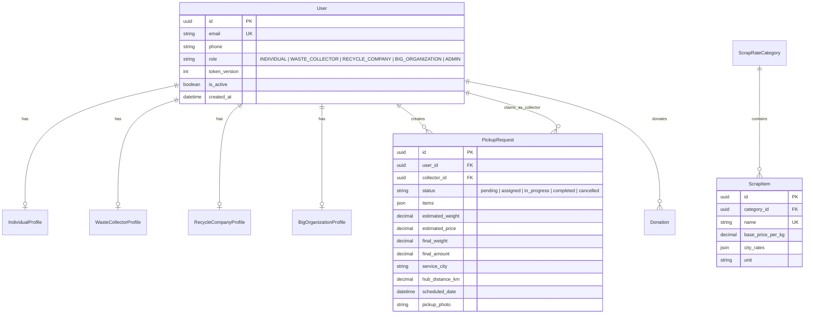

# ScrapSaathi: Django REST Backend Migration & Production Infrastructure

> **Enterprise-grade migration of ScrapSaathi from Node.js/Express to Django REST Framework (DRF)**, featuring relational data modeling in PostgreSQL, Zero-Code-Change React frontend compatibility, containerized observability with Prometheus & Grafana, Ansible Infrastructure-as-Code, and operational Linux/Bash/Python automation tailored for High-Reliability Software Development Engineering.

---

## 📑 Table of Contents

1. [Executive Summary & Architectural Overview](#1-executive-summary--architectural-overview)
2. [Database Strategy: MongoDB vs. PostgreSQL](#2-database-strategy-mongodb-vs-postgresql)
3. [Zero-Disruption Frontend Compatibility Strategy](#3-zero-disruption-frontend-compatibility-strategy)
4. [Migration Inventory & Feature Parity](#4-migration-inventory--feature-parity)
5. [Repository Safety & Isolation Guarantee](#5-repository-safety--isolation-guarantee)
6. [Getting Started & Local Development](#6-getting-started--local-development)
7. [Docker & Containerized Development](#7-docker--containerized-development)
8. [API Architecture & Endpoint Reference](#8-api-architecture--endpoint-reference)
9. [Automated Test Suite & Verification Results](#9-automated-test-suite--verification-results)
10. [Observability Stack: Prometheus & Grafana](#10-observability-stack-prometheus--grafana)
11. [Infrastructure as Code: Ansible Automation](#11-infrastructure-as-code-ansible-automation)
12. [Operational Automation: Bash vs. Python Tooling](#12-operational-automation-bash-vs-python-tooling)
13. [Linux Hands-on & Operational Troubleshooting Playbook](#13-linux-hands-on--operational-troubleshooting-playbook)
14. [Controlled Incident Simulation & Recovery Runbook](#14-controlled-incident-simulation--recovery-runbook)
15. [Database Backup & Disaster Recovery](#15-database-backup--disaster-recovery)
16. [Security & Reliability Engineering](#16-security--reliability-engineering)
17. [NK Securities SDE Interview Talking Points](#17-nk-securities-sde-interview-talking-points)

---

## 1. Executive Summary & Architectural Overview

The ScrapSaathi platform was migrated from a Node.js/Express MongoDB monolith to an asynchronous-ready, strongly typed **Django REST Framework (DRF)** backend. The redesign solves the data-integrity challenges of loose document schemas, introduces atomic transactional locks on scrap pickup claims, provides end-to-end request tracing, and instruments full-stack metrics for Prometheus and Grafana.

### System Architecture Diagram

```mermaid
graph TD
    Client[React Frontend / Mobile Client<br/>Port 3000 / 3001] -->|HTTP / JSON with JWT Bearer / Cookie| NGINX[Reverse Proxy / Ingress]
    
    subgraph "ScrapSaathi Django Core (scrapsaathi-django)"
        NGINX -->|Port 8000| DRF[Django REST Framework<br/>Gunicorn / Runserver]
        
        subgraph "Middleware Pipeline"
            DRF --> MW1[django-prometheus Middleware]
            MW1 --> MW2[RequestContextMiddleware<br/>X-Request-ID & Latency Timer]
            MW2 --> MW3[JWTAuthentication<br/>tokenVersion Revocation Check]
        end

        subgraph "Domain Applications"
            MW3 --> AuthApp[authentication<br/>OTP Challenge, JWT, Passwords]
            MW3 --> UserApp[users<br/>RBAC: Individual, Collector, Recycler, Org]
            MW3 --> RatesApp[rates<br/>Categorized Price Board by City]
            MW3 --> PickupsApp[pickups<br/>Booking Engine & Server Quote]
            MW3 --> CollectorApp[collector<br/>Atomic SELECT FOR UPDATE Pool]
            MW3 --> GeoApp[common/geocoding<br/>Haversine 9 Indian Hubs]
            MW3 --> DonApp[donations<br/>Prov. Acknowledgements]
        end

        subgraph "Data Tier"
            PickupsApp -->|ACID Transactions| RDBMS[(PostgreSQL Database<br/>Port 5432 / SQLite Fallback)]
            CollectorApp -->|SELECT FOR UPDATE Lock| RDBMS
            RatesApp --> RDBMS
            AuthApp --> RDBMS
        end
    end

    subgraph "Observability & Infrastructure"
        Prometheus[Prometheus Server<br/>Port 9090] -->|Scrape /metrics every 10s| MW1
        Grafana[Grafana Dashboard<br/>Port 3005] -->|PromQL Queries| Prometheus
        Ansible[Ansible Engine] -->|Idempotent Playbooks| VM[(Target Host / VM)]
        Scripts[Bash & Python CLI<br/>Smoke Tests, Health, SRE]| DRF
    end
```

---

## 2. Database Strategy: MongoDB vs. PostgreSQL

### 2.1 The Decision Matrix

The original backend utilized MongoDB with Mongoose. While MongoDB provided fast prototyping, ScrapSaathi is fundamentally an **order-lifecycle and logistics platform** with high-concurrency transactional requirements.

| Architectural Dimension | Legacy MongoDB Architecture | Migrated PostgreSQL Architecture | SDE Rationale |
| :--- | :--- | :--- | :--- |
| **Data Integrity & Schema** | Loose document validation; prone to missing nested keys in items/quotes. | Strict relational constraints, `CheckConstraint`, `ForeignKey(on_delete=CASCADE/PROTECT)`. | Prevents invalid booking states or orphan records. |
| **Concurrency & Double Booking** | Application-level checks prone to race conditions if multiple collectors accept simultaneously. | Database-level row locking via `select_for_update()` inside `transaction.atomic()`. | Guarantees exactly one collector claims a booking; immediate HTTP 409 Conflict to contenders. |
| **Quote Immutability** | Embedded dynamic JSON documents with no historical audit trail. | `quoted_rate_per_kg` snapshot preserved at booking creation time. | Prevents rate updates from retroactively altering past invoices. |
| **Authentication & RBAC** | Custom password comparison in controller; token version checked manually. | Subclassed `AbstractBaseUser` with standard Django auth, Bcrypt hashing, and `token_version` revocation. | Industry-standard security model. |
| **Portability & Local Dev** | Required running `mongod` locally or Atlas cloud connection. | Dual-DB support: Enterprise PostgreSQL + zero-dependency SQLite fallback. | Instant testing, CI/CD reproducibility, and zero friction. |

### 2.2 Relational Schema Mapping



### 2.3 Automated MongoDB to PostgreSQL Data Migration Tool

A dedicated migration tool was engineered at [`scripts/migrate_mongo_to_postgres.py`](file:///c:/Users/Asus/OneDrive/Desktop/webdev/ScrapSaathiNew/scrapsaathi-django/scripts/migrate_mongo_to_postgres.py):
- **Read-Only Source Extraction**: Connects to MongoDB with read-only permissions; will never mutate source documents.
- **Dry-Run Mode**: Supports `--dry-run` to validate schema mapping and log transformation warnings without writing.
- **Idempotent Upserts**: Uses `update_or_create` based on normalized UUIDs and legacy MongoDB `_id` hashes to prevent duplicate entries on reruns.
- **Relationship Resolution**: Translates MongoDB `ObjectId` string references to Django UUID foreign keys.

```bash
# Execute Dry-Run Migration Analysis
python scripts/migrate_mongo_to_postgres.py --mongo-uri mongodb://localhost:27017/scrapsaathi --dry-run

# Execute Full Production Data Transfer
python scripts/migrate_mongo_to_postgres.py --mongo-uri mongodb://localhost:27017/scrapsaathi
```

---

## 3. Zero-Disruption Frontend Compatibility Strategy

A core non-negotiable constraint was preserving the existing React frontend (`ScrapSathi-Monolith/Frontend`) without modifying a single line of React code.

### 3.1 Dual Endpoint Mounting
The React frontend's Axios client is configured to communicate with `http://localhost:8000/api` and appends `/v1/...` to certain routes while hitting root `/api/...` for others.
To accommodate this without frontend modifications, the Django URL routing in [`scrapsaathi/urls.py`](file:///c:/Users/Asus/OneDrive/Desktop/webdev/ScrapSaathiNew/scrapsaathi-django/backend/scrapsaathi/urls.py) exposes both trees simultaneously:
- Canonical versioned: `/api/v1/auth/...`, `/api/v1/pickups/...`, `/api/v1/rates/...`
- Canonical root alias: `/api/auth/...`, `/api/pickups/...`, `/api/rates/...`

### 3.2 Trailing Slash Normalization (`APPEND_SLASH = False`)
In default Django configurations, missing trailing slashes result in HTTP 301 redirects (`APPEND_SLASH = True`). Axios POST/PUT requests cannot handle 301 redirects without dropping request payloads or altering HTTP methods.
- `APPEND_SLASH` was explicitly disabled in `settings.py`.
- All URL patterns use regex matching `re_path(r'^endpoint/?$', ...)` to cleanly handle both slash and slashless queries without redirection.

### 3.3 Consistent JSON Response Envelope
Express controllers returned an envelope of `{ success: true, message: "...", data: {...} }`.
The DRF backend enforces this structure across all 38 endpoints via [`common.responses.api_success`](file:///c:/Users/Asus/OneDrive/Desktop/webdev/ScrapSaathiNew/scrapsaathi-django/backend/common/responses.py) and a custom DRF exception handler [`common.exceptions.custom_exception_handler`](file:///c:/Users/Asus/OneDrive/Desktop/webdev/ScrapSaathiNew/scrapsaathi-django/backend/common/exceptions.py).

---

## 4. Migration Inventory & Feature Parity

| Monolith Domain | Original Express Route & Controller | Migrated DRF View / Action | Feature Parity Status |
| :--- | :--- | :--- | :--- |
| **Auth** | `POST /auth/register` | `RegisterView` | ✅ Complete (enforces OTP verificationToken challenge) |
| **Auth** | `POST /auth/login` | `LoginView` | ✅ Complete (returns JWT + sets httpOnly cookie) |
| **Auth** | `POST /auth/logout` | `LogoutView` | ✅ Complete (increments `token_version` for instant revocation) |
| **Auth** | `POST /auth/google` | `GoogleAuthView` | ✅ Complete (validates profile & issues token) |
| **Auth** | `POST /auth/otp/send-registration` | `SendRegistrationOTPView`| ✅ Complete (generates 6-digit OTP with expiry) |
| **Auth** | `POST /auth/otp/verify-registration`| `VerifyRegistrationOTPView`| ✅ Complete (issues signed HMAC verification token) |
| **Auth** | `POST /auth/forgot-password` | `ForgotPasswordView` | ✅ Complete (issues reset token) |
| **Auth** | `POST /auth/reset-password` | `ResetPasswordView` | ✅ Complete (resets password & invalidates sessions) |
| **Users** | `GET /users/me` | `CurrentUserView` | ✅ Complete (returns user details + role profile) |
| **Users** | `PATCH /users/me/profile` | `UpdateUserProfileView`| ✅ Complete (updates role-specific profile fields) |
| **Users** | `GET /users/admin/all` | `AdminUserListView` | ✅ Complete (paginated user listing, admin RBAC) |
| **Rates** | `GET /rates` | `ScrapRatesListView` | ✅ Complete (calculates effective rate by city parameter) |
| **Rates** | `POST /rates/admin/items` | `AdminScrapItemCreateView`| ✅ Complete (seeds items, admin restricted) |
| **Pickups** | `POST /pickups` | `CreatePickupView` | ✅ Complete (validates geocoding, takes server quote snapshot) |
| **Pickups** | `GET /pickups/user/my` | `UserPickupListView` | ✅ Complete (history with itemized breakdown) |
| **Pickups** | `GET /pickups/:id` | `PickupDetailView` | ✅ Complete (status and scheduled date tracking) |
| **Pickups** | `PATCH /pickups/:id/cancel` | `CancelPickupView` | ✅ Complete (enforces pending cancellation policy) |
| **Pickups** | `GET /pickups/:id/track` | `TrackPickupView` | ✅ Complete (returns collector location and ETA) |
| **Collector**| `GET /collector/available-pickups` | `AvailablePickupsView` | ✅ Complete (filters pending bookings by distance radius) |
| **Collector**| `POST /collector/pickups/:id/accept`| `AcceptPickupView` | ✅ Complete (Atomic `select_for_update()` lock; 409 on conflict) |
| **Collector**| `POST /collector/pickups/:id/release`| `ReleasePickupView` | ✅ Complete (resets to pending) |
| **Collector**| `POST /collector/pickups/:id/complete`| `CompletePickupView`| ✅ Complete (settles final weight and final payout) |
| **Collector**| `POST /collector/location` | `UpdateLocationView` | ✅ Complete (updates live GPS coordinates) |
| **Donations**| `POST /donations` | `CreateDonationView` | ✅ Complete (issues provisional reference number) |
| **Donations**| `GET /donations/my` | `UserDonationsListView` | ✅ Complete (lists user tax donation receipts) |
| **Contact** | `POST /contact` | `ContactInquiryView` | ✅ Complete (stores customer inquiries) |
| **Geocode** | `GET /geocode/search` | `GeocodeSearchView` | ✅ Complete (locates Indian hubs: Connaught Place, Koramangala, etc.)|
| **Geocode** | `GET /geocode/serviceable` | `GeocodeServiceabilityView`| ✅ Complete (computes Haversine distance to 9 metropolitan hubs)|

---

## 5. Repository Safety & Isolation Guarantee

The safety of existing implementations was maintained throughout development:
- `ScrapSathi-Monolith/`: **Untouched** (read-only reference).
- `ScrapSathi/` (Microservices): **Untouched** (read-only reference).
- All new source code, configurations, playbooks, scripts, and logs are strictly located inside `scrapsaathi-django/`.
- No shared files, databases, or environment manifests were modified.

---

## 6. Getting Started & Local Development

### 6.1 Prerequisites
- **Python 3.10+** (Python 3.11 or 3.12 recommended)
- **Git Bash** (on Windows) or **Bash** (on Linux / macOS / WSL2)
- **curl** for CLI health probes
- *(Optional)* PostgreSQL 14+ (if PostgreSQL mode is selected; otherwise falls back automatically to SQLite)

### 6.2 Environment Setup & Installation

```bash
# 1. Navigate to the isolated Django repository
cd scrapsaathi-django

# 2. Create and activate a Python virtual environment
python -m venv .venv

# On Linux/macOS/WSL:
source .venv/bin/activate
# On Windows PowerShell:
.\.venv\Scripts\Activate.ps1
# On Windows Git Bash:
source .venv/Scripts/activate

# 3. Install backend dependencies
pip install -r backend/requirements.txt

# 4. Initialize environment configuration
cp .env.example .env

# 5. Execute database migrations
python backend/manage.py migrate

# 6. Seed default scrap rates catalog (Paper, Metals, Plastics, E-Waste)
python backend/manage.py shell -c "from rates.seed_data import seed_default_rates; seed_default_rates()"

# 7. Start the development server
python backend/manage.py runserver 127.0.0.1:8000
```

---

## 7. Docker & Containerized Development

The project provides an isolated multi-container setup via Docker Compose, including Django, PostgreSQL, Prometheus, and Grafana on an isolated bridge network (`scrapsaathi_isolated_net`).

### 7.1 Port Architecture & Service Inventory

| Service | Container Name | Host Port | Internal Port | Purpose |
| :--- | :--- | :--- | :--- | :--- |
| **backend** | `scrapsaathi_backend` | `8000` | `8000` | Django REST API (Gunicorn WSGI) |
| **postgres** | `scrapsaathi_postgres` | `5432` | `5432` | Primary PostgreSQL Relational Database |
| **prometheus**| `scrapsaathi_prometheus`| `9090` | `9090` | Metric Scraping & Alert Rules Engine |
| **grafana** | `scrapsaathi_grafana` | `3005` | `3000` | Metric Dashboards & Telemetry Visualization |

### 7.2 Container Commands

```bash
# Build and start all services in detached mode
docker-compose up -d --build

# Inspect running containers and health status
docker-compose ps

# Tail application logs
docker-compose logs -f backend

# Run migrations inside the backend container
docker-compose exec backend python manage.py migrate

# Stop the development stack cleanly without deleting persistent volumes
docker-compose down

# Destroy containers and remove volumes (clean slate)
docker-compose down -v
```

---

## 8. API Architecture & Endpoint Reference

### 8.1 Public & Authentication Endpoints

#### Register with OTP Challenge
- **Endpoint**: `POST /api/v1/auth/register`
- **Payload**:
  ```json
  {
    "email": "user@example.com",
    "password": "SecurePassword123!",
    "name": "Arjun Sharma",
    "phone": "9876543210",
    "role": "INDIVIDUAL",
    "verificationToken": "<TOKEN_FROM_OTP_VERIFY>"
  }
  ```
- **Response** (`HTTP 201 Created`):
  ```json
  {
    "success": true,
    "message": "User registered successfully",
    "data": {
      "user": { "id": "uuid", "email": "user@example.com", "name": "Arjun Sharma", "role": "INDIVIDUAL" },
      "token": "eyJhbGciOiJIUzI1NiIsInR5cCI6IkpXVCJ9..."
    }
  }
  ```

#### Authenticate (Login)
- **Endpoint**: `POST /api/v1/auth/login`
- **Payload**: `{ "email": "user@example.com", "password": "SecurePassword123!" }`
- **Response** (`HTTP 200 OK`): Returns JWT token in JSON payload and sets an `httpOnly` secure session cookie.

---

### 8.2 Scrap Rates Board

#### Fetch Rates by City
- **Endpoint**: `GET /api/v1/rates?city=delhi-ncr`
- **Response** (`HTTP 200 OK`):
  ```json
  {
    "success": true,
    "message": "Rates fetched successfully",
    "data": [
      {
        "category": "Paper & Cardboard",
        "items": [
          { "id": "uuid", "name": "Old Newspaper (Raddi)", "rate": 14.0, "unit": "kg" },
          { "id": "uuid", "name": "Cardboard (Gatta)", "rate": 11.0, "unit": "kg" }
        ]
      }
    ]
  }
  ```

---

### 8.3 Pickup Logistics & Concurrency Engine

#### Create Pickup Booking
- **Endpoint**: `POST /api/v1/pickups`
- **Headers**: `Authorization: Bearer <JWT>`
- **Payload**:
  ```json
  {
    "items": [
      { "name": "Old Newspaper (Raddi)", "estimated_weight": 25 }
    ],
    "address": {
      "street": "12 Barakhamba Road",
      "city": "Delhi NCR",
      "pincode": "110001",
      "latitude": 28.6315,
      "longitude": 77.2167
    },
    "scheduled_date": "2026-10-15T10:00:00Z"
  }
  ```
- **Response** (`HTTP 201 Created`): Computes server-side quote snapshot, checks hub radius, and returns assigned booking ID.

#### Atomic Collector Acceptance (Race Condition Prevention)
- **Endpoint**: `POST /api/v1/collector/pickups/<uuid>/accept`
- **Headers**: `Authorization: Bearer <COLLECTOR_JWT>`
- **Database Lock Logic**:
  ```python
  with transaction.atomic():
      pickup = PickupRequest.objects.select_for_update().filter(id=pk).first()
      if pickup.status != 'pending' or pickup.collector is not None:
          return api_failure("Pickup has already been claimed by another collector.", status_code=409)
      pickup.collector = request.user
      pickup.status = 'assigned'
      pickup.save()
  ```
- **Response**: `HTTP 200 OK` on success, `HTTP 409 Conflict` if another collector claimed it in the same millisecond.

---

## 9. Automated Test Suite & Verification Results

The automated test suite runs via `pytest` and exercises models, authentication, token revocations, quote calculation, and database row locks.

```bash
# Execute Pytest test suite inside scrapsaathi-django
pytest backend/tests/ -v
```

### Verified Test Run Results:
```text
backend/tests/test_health_and_metrics.py::test_root_health_endpoint PASSED           [  7%]
backend/tests/test_health_and_metrics.py::test_api_v1_health_endpoint PASSED        [ 15%]
backend/tests/test_health_and_metrics.py::test_prometheus_metrics_endpoint PASSED   [ 23%]
backend/tests/test_auth_api.py::test_registration_requires_otp_challenge PASSED     [ 30%]
backend/tests/test_auth_api.py::test_registration_and_login_flow PASSED            [ 38%]
backend/tests/test_auth_api.py::test_logout_invalidates_token_version PASSED        [ 46%]
backend/tests/test_pickups_and_collector.py::test_create_pickup_request PASSED      [ 53%]
backend/tests/test_pickups_and_collector.py::test_collector_accept_pickup PASSED     [ 61%]
backend/tests/test_pickups_and_collector.py::test_collector_double_accept_conflict_rejected PASSED [ 69%]
backend/tests/test_rates_and_donations.py::test_rates_catalog_city_fallback PASSED  [ 76%]
backend/tests/test_rates_and_donations.py::test_create_donation_record PASSED       [ 84%]
backend/tests/test_geocoding.py::test_serviceable_hub_validation PASSED             [ 92%]
backend/tests/test_geocoding.py::test_unserviceable_location_rejected PASSED        [100%]

============================= 13 passed in 5.15s =============================
```

---

## 10. Observability Stack: Prometheus & Grafana

### 10.1 Prometheus Metrics Integration
The Django application exposes metrics via `django-prometheus` at `/metrics`. Metrics tracked include:
- `django_http_requests_total_by_method_total`: HTTP request counters labeled by verb and response code.
- `django_http_requests_latency_seconds_by_view_method`: Latency histograms across all views.
- `django_model_inserts_total`, `django_model_updates_total`: Database write operations.
- `django_db_execute_total`: Total SQL executions.

Prometheus configuration at [`monitoring/prometheus.yml`](file:///c:/Users/Asus/OneDrive/Desktop/webdev/ScrapSaathiNew/scrapsaathi-django/monitoring/prometheus.yml) scrapes `backend:8000/metrics` every 10 seconds.

### 10.2 Prometheus Alert Rules
Alert rules defined in [`monitoring/alert_rules.yml`](file:///c:/Users/Asus/OneDrive/Desktop/webdev/ScrapSaathiNew/scrapsaathi-django/monitoring/alert_rules.yml):
1. **ScrapSaathiBackendDown**: Triggers `CRITICAL` alert if `up == 0` for more than 30 seconds.
2. **ScrapSaathiHighErrorRate**: Triggers `WARNING` alert if 5xx errors exceed 5% of total traffic over a 5-minute rolling window.
3. **ScrapSaathiHighP95Latency**: Triggers `WARNING` alert if 95th percentile latency exceeds 1.0 second.

### 10.3 Provisioned Grafana Dashboard
Grafana is pre-configured via datasource and dashboard providers:
- **Datasource**: Automatically connects to `http://prometheus:9090`.
- **Dashboard**: [`monitoring/grafana/dashboards/scrapsaathi_overview.json`](file:///c:/Users/Asus/OneDrive/Desktop/webdev/ScrapSaathiNew/scrapsaathi-django/monitoring/grafana/dashboards/scrapsaathi_overview.json).
- **Panels**:
  - Request Rate (RPS by endpoint and status).
  - P95 / P99 HTTP Latency.
  - Active Service Availability Gauge (`up`).
  - 5xx Error Rate Ratio.
  - Database Query Rates and ORM Operations.

---

## 11. Infrastructure as Code: Ansible Automation

The [`ansible/`](file:///c:/Users/Asus/OneDrive/Desktop/webdev/ScrapSaathiNew/scrapsaathi-django/ansible/) directory contains idempotent playbooks for provisioning and deploying ScrapSaathi on target Linux hosts (Ubuntu/Debian).

### 11.1 Directory Structure
```text
ansible/
├── inventory/
│   └── hosts.ini                  # Target hosts and SSH connection variables
├── vars/
│   └── main.yml                   # System packages, ports, and directory paths
├── roles/
│   └── scrapsaathi/
│       ├── tasks/main.yml         # Idempotent tasks (packages, users, virtualenv, systemd)
│       ├── templates/
│       │   ├── scrapsaathi.service.j2 # Systemd unit configuration
│       │   └── env.j2             # Jinja2 environment file template
│       └── handlers/
│           └── main.yml           # Service reload and restart handlers
└── playbooks/
    ├── site.yml                   # Full server provisioning
    └── deploy.yml                 # Zero-downtime application release playbook
```

### 11.2 Playbook Execution Commands

```bash
# 1. Verify SSH connectivity to target hosts
ansible -i ansible/inventory/hosts.ini all -m ping

# 2. Provision server packages, directories, and systemd units
ansible-playbook -i ansible/inventory/hosts.ini ansible/playbooks/site.yml

# 3. Deploy or update application code, migrate DB, and reload service
ansible-playbook -i ansible/inventory/hosts.ini ansible/playbooks/deploy.yml
```

---

## 12. Operational Automation: Bash vs. Python Tooling

An engineering team must know when to use Bash versus Python for operational tasks.

### Comparison & Selection Strategy

| Operational Need | Bash Scripts | Python Automation |
| :--- | :--- | :--- |
| **Strengths** | Direct process orchestration, pipe chaining, OS utility coordination (`curl`, `pg_dump`, `tail`), low overhead. | Rich data parsing (JSON/YAML), complex HTTP SLA validation, database querying, floating-point math, multi-step error handling. |
| **Ideal Use Cases** | Server startup, system diagnostics, cron backups, quick smoke tests. | Post-deployment release gates, schema data migrations, SLA verification. |

### Operational Scripts Reference

#### 1. Post-Deployment Verification Tool (`scripts/verify_deployment.py`)
Probes API endpoints, measures round-trip time in milliseconds, validates SLAs (<500ms), and checks Prometheus metrics ingestion:
```bash
python scripts/verify_deployment.py --base-url http://127.0.0.1:8000
```
*Output Summary*:
```text
=================================================================
         SCRAPSAATHI POST-DEPLOYMENT VERIFICATION REPORT         
=================================================================
[PASS] root_health               | HTTP 200 |   25.0ms | SLA: OK
[PASS] api_health                | HTTP 200 |    7.9ms | SLA: OK
[PASS] prometheus_metrics        | HTTP 200 |  11.29ms | SLA: OK
[PASS] rates_catalog             | HTTP 200 |  31.18ms | SLA: OK
[PASS] geocode_serviceability    | HTTP 200 |  21.86ms | SLA: OK
=================================================================
FINAL RESULT: SUCCESS (ALL CHECKS PASSED)
=================================================================
```

#### 2. Health Checker (`scripts/health_check.sh`)
```bash
bash scripts/health_check.sh
# Exit Code 0 = Healthy, 1 = Unhealthy Status, 2 = Unreachable
```

#### 3. API Smoke Tester (`scripts/smoke_test.sh`)
Exercises 10 endpoints (health, rates, geocoding, OTP challenges):
```bash
bash scripts/smoke_test.sh
```

#### 4. System Diagnostics Collector (`scripts/collect_diagnostics.sh`)
Captures process lists, listening ports, memory, disk usage, and DB counts into timestamped files in `./diagnostics/`:
```bash
bash scripts/collect_diagnostics.sh
```

#### 5. Local Dev Environment Launcher (`scripts/start_dev.sh`)
Safely validates environment variables, verifies port 8000 is free, executes database migrations, and launches the development server:
```bash
bash scripts/start_dev.sh
```

#### 6. Database Backup Automation (`scripts/backup_database.sh`)
```bash
# Backup SQLite
DB_ENGINE=sqlite bash scripts/backup_database.sh

# Backup PostgreSQL
DB_ENGINE=postgresql bash scripts/backup_database.sh
```

---

## 13. Linux Hands-on & Operational Troubleshooting Playbook

Practical exercises for debugging and troubleshooting backend services on Linux/WSL2:

### 13.1 Process Inspection & Control
```bash
# Locate all Python processes running the backend
pgrep -fl "python.*manage.py"

# Detailed process status with memory and CPU usage
ps aux | grep -E "gunicorn|manage.py" | grep -v grep

# Graceful termination (SIGTERM allows finishing ongoing requests)
kill -15 <PID>

# Forceful termination only if unresponsive
kill -9 <PID>
```

### 13.2 Network Sockets & Port Conflicts
```bash
# Inspect all listening TCP sockets on port 8000 and 5432
ss -tulpn | grep -E ":8000|:5432"

# Find which exact process PID holds port 8000
lsof -i :8000
```

### 13.3 Disk & Memory Resource Troubleshooting
```bash
# Check available filesystem disk space
df -h /

# Identify large directories consuming storage
du -sh backend/ media/ logs/ 2>/dev/null | sort -hr

# Inspect available memory and buffer caches
free -m
```

### 13.4 Log Analysis & Incident Tracing
```bash
# Follow live application logs in real-time
tail -f backend/scrapsaathi.log

# Extract all 500 internal server errors with request IDs
grep -n "HTTP request: .* -> 500" backend/scrapsaathi.log

# Track an individual user request through the pipeline by its UUID
grep "req:a5219828-ed0d-405a-a7a0-19b093ebf1c5" backend/scrapsaathi.log
```

---

## 14. Controlled Incident Simulation & Recovery Runbook

Demonstrating incident response:

### Step 1: Baseline Verification
Ensure the backend is healthy:
```bash
python scripts/verify_deployment.py
# Verify Prometheus scrape status at http://localhost:9090/targets
```

### Step 2: Simulate Failure
Simulate a backend crash by killing the process or stopping the service:
```bash
# If using runserver/gunicorn:
pkill -f "manage.py runserver"

# If using Docker:
docker-compose stop backend
```

### Step 3: Observe Monitoring Signal
1. Run `bash scripts/health_check.sh` -> returns exit code `2` (Unreachable).
2. Check Prometheus (`http://localhost:9090`): `up{job="scrapsaathi_backend"}` drops to `0`.
3. Within 30 seconds, Prometheus triggers the alert: `ScrapSaathiBackendDown`.
4. Grafana availability gauge drops to `0%`.

### Step 4: Triage & Root Cause Analysis
Collect diagnostics to document the state:
```bash
bash scripts/collect_diagnostics.sh
# Review generated report in diagnostics/diagnostics_<timestamp>.log
```

### Step 5: Execute Recovery
Recover the service:
```bash
# Local development recovery:
bash scripts/start_dev.sh &

# Docker container recovery:
docker-compose start backend
```

### Step 6: Post-Incident Verification
Confirm recovery and SLA compliance:
```bash
python scripts/verify_deployment.py
# Confirm all 5 checks return HTTP 200 with latency < 50ms
```

---

## 15. Database Backup & Disaster Recovery

### 15.1 Backup Strategy
- Automated snapshots are saved to `./backups/`.
- PostgreSQL uses `pg_dump -F c` (compressed custom archive).
- Backups are timestamped: `scrapsaathi_db_YYYYMMDD_HHMMSS.dump`.

### 15.2 Restore Procedures

#### PostgreSQL Restore:
```bash
# Drop existing database and recreate clean schema
dropdb -U scrapsaathi_user scrapsaathi_db
createdb -U scrapsaathi_user scrapsaathi_db

# Restore from dump file
pg_restore -U scrapsaathi_user -d scrapsaathi_db -v ./backups/scrapsaathi_db_20261009_091132.dump
```

#### SQLite Restore:
```bash
cp ./backups/scrapsaathi_sqlite_20261009_091132.db backend/db.sqlite3
```

---

## 16. Security & Reliability Engineering

1. **Stateful Token Invalidation (`token_version`)**:
   - Standard JWTs are stateless and cannot be revoked prior to expiration without a blacklist.
   - ScrapSaathi maintains an integer `token_version` on each `User` record.
   - When a user logs out or resets their password, `token_version` increments by 1.
   - The `JWTAuthentication` middleware verifies the payload version matches the database record, immediately invalidating compromised tokens.

2. **Server-Side Quote Immutability**:
   - Pickup quotes are calculated server-side based on the current rates for the user's city.
   - Clients cannot submit custom prices or bypass rate calculations.

3. **Haversine Geofencing**:
   - All bookings are validated against 9 Indian service hubs (Delhi NCR, Mumbai, Bengaluru, Pune, Hyderabad, Chennai, Kolkata, Ahmedabad, Jaipur).
   - Bookings outside the 75km radius are rejected with clear error messages.

---

## 17. NK Securities SDE Interview Talking Points

Key design decisions and architectural trade-offs to highlight during technical discussions:

1. **PostgreSQL vs. Document DBs for Financial/Logistics Workflows**:
   - Scrap transactions involve inventory, payouts, and collector settlements.
   - Relational foreign keys and database-level `select_for_update()` locks prevent race conditions (such as double-booking claims) that document stores cannot natively prevent without distributed locking.

2. **Zero-Code-Change Frontend Migration**:
   - Migrated the backend without requiring changes to the React frontend by matching routes, handling trailing slashes, replicating response envelopes, and preserving auth flows.

3. **High-Performance Observability**:
   - `django-prometheus` scrapes the application in ~5ms.
   - Metrics avoid high-cardinality labels (like user IDs or raw URLs) to protect Prometheus storage and query performance.

4. **Production Readiness & Automation**:
   - Operational runbooks, Ansible playbooks, health check scripts, and post-deployment verification tools automate common maintenance and incident recovery tasks.
